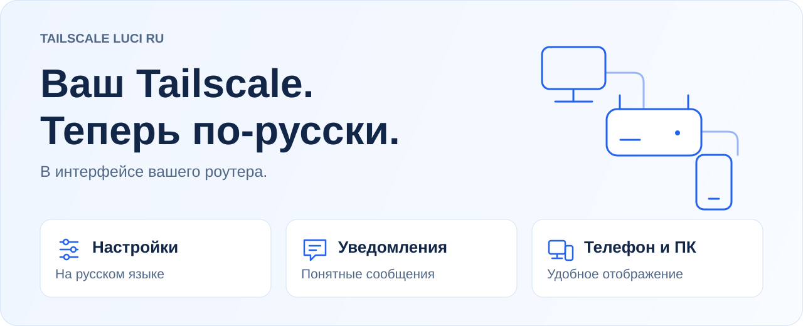
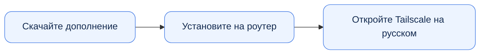

<h1 align="center">Tailscale LuCI RU</h1>

<picture>
  <source media="(max-width: 600px) and (prefers-color-scheme: dark)" srcset="docs/assets/overview-dark-mobile.svg">
  <source media="(max-width: 600px)" srcset="docs/assets/overview-light-mobile.svg">
  <source media="(prefers-color-scheme: dark)" srcset="docs/assets/overview-dark.svg">
  
</picture>

  Русский перевод и оформление Tailscale Community для OpenWrt. 
  Всё в одном дополнении.

  <strong><a href="https://github.com/Ra1nek/tailscale-luci-ru/actions/workflows/build.yml">Получить пакет →</a></strong> ·
  <a href="docs/INSTALL.md">Как установить</a> ·
  <a href="https://github.com/Ra1nek/tailscale-luci-ru/issues">Помощь</a>

## Три шага до русской страницы

1. **Получите пакет.** Откройте последнюю успешную сборку ветки `main` и скачайте архив в разделе **Artifacts**. Для скачивания нужен вход в GitHub.
2. **Установите дополнение.** Передайте файл на роутер и выполните команды из [пошаговой инструкции](docs/INSTALL.md).
3. **Откройте страницу.** Выберите русский язык в LuCI и перейдите в **VPN → Tailscale**.

## Подойдёт ли моему роутеру?

Дополнение рассчитано на **OpenWrt 25.12** и приложение **Tailscale Community**. Перевод и оформление устанавливаются вместе. Пакет подходит для разных процессоров.

<strong>Совместимость и текущая проверка</strong>

Нужно приложение `luci-app-tailscale-community`. Единый пакет прошёл сборку SDK и автоматические проверки. Оформление проверялось со страницей Tailscale Community **4.5.1-r1** при разработке исходных дополнений. Отдельная проверка объединённой установки в браузере ещё предстоит.

[Подробности совместимости и проверки](docs/DEVELOPMENT.md#проверенные-версии)

## Нужна помощь?

Нашли неточный перевод или заметили, что страница отображается неправильно? Приложите снимок экрана и укажите версии OpenWrt и Tailscale Community. Скройте адреса устройств и ключи.

**[Сообщить об ошибке →](https://github.com/Ra1nek/tailscale-luci-ru/issues/new)**

<strong>Почему уведомление осталось на английском?</strong>

Дополнение переводит известные сообщения состояния. Новое сообщение от Tailscale может появиться раньше его перевода. Пришлите текст — его можно будет добавить в следующую версию.

---

  <strong>Создано на основе открытых проектов</strong> 
  <a href="https://github.com/Tokisaki-Galaxy/luci-app-tailscale-community">Tailscale Community</a> ·
  <a href="https://github.com/nagual2/luci-i18n-tailscale-community-ru">Русский перевод nagual2</a> ·
  <a href="https://github.com/openwrt/luci">OpenWrt LuCI</a>

  <a href="CONTRIBUTING.md">Предложить улучшение</a> ·
  <a href="docs/DEVELOPMENT.md">Для разработчиков</a> ·
  <a href="NOTICE">Авторство</a> ·
  <a href="LICENSE">Apache-2.0</a>

  

