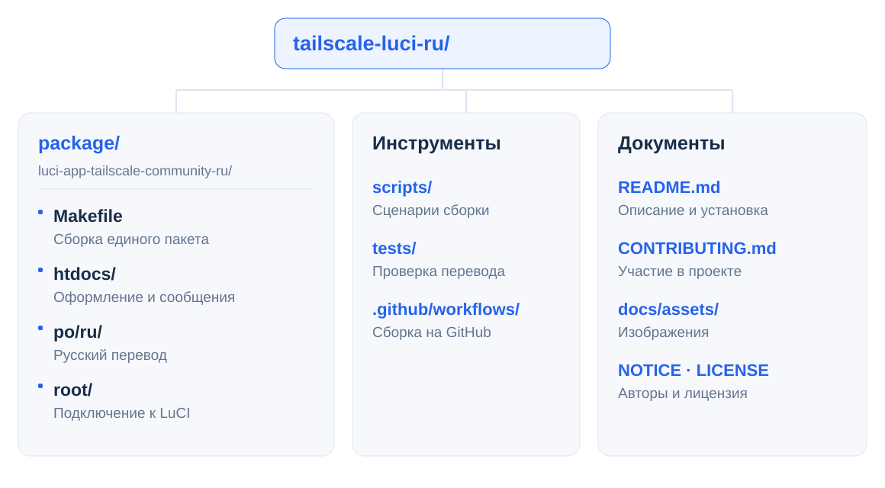

<p align="center">
  
</p>

<h1 align="center">Tailscale LuCI RU</h1>

<p align="center">
  <strong>Tailscale в LuCI — по-русски.</strong><br>
  Русский перевод и оформление Tailscale Community для OpenWrt.
</p>

<p align="center">
  <a href="https://github.com/Ra1nek/tailscale-luci-ru/actions/workflows/build.yml"></a>
  <a href="#совместимость"></a>
  <a href="LICENSE"></a>
</p>

<p align="center">
  <a href="#установка">Установка</a> ·
  <a href="#совместимость">Совместимость</a> ·
  <a href="#структура-проекта">Структура проекта</a> ·
  <a href="https://github.com/Ra1nek/tailscale-luci-ru/issues">Помощь</a>
</p>

---

## Что меняется

| Возможность | Что получите |
| --- | --- |
| **Русские настройки** | Названия и пояснения на русском языке. |
| **Понятные уведомления** | Перевод известных сообщений о состоянии Tailscale. |
| **Удобнее с телефона** | Исправленные переносы, подписи, кнопки и заголовки таблицы устройств. |

Перевод и оформление устанавливаются одним дополнением и применяются к русской странице Tailscale.

## Совместимость

Нужны **OpenWrt 25.12** и приложение **Tailscale Community** (`luci-app-tailscale-community`). Пакет подходит для разных процессоров.

## Установка

### 1. Скачайте дополнение

Откройте последнюю успешную сборку ветки `main`. В разделе **Artifacts** скачайте архив **luci-app-tailscale-community-ru-openwrt-25.12.6** и распакуйте его. Для скачивания нужен вход в GitHub.

**[Открыть сборки и скачать APK →](https://github.com/Ra1nek/tailscale-luci-ru/actions/workflows/build.yml)**

### 2. Передайте файл на роутер

Скопируйте APK в `/tmp` на роутере. Например, из папки с распакованным архивом выполните команду ниже. Замените `192.168.1.1` на адрес своего роутера.

```sh
scp -O luci-app-tailscale-community-ru-1.1.0-r1.apk root@192.168.1.1:/tmp/
```

### 3. Установите пакет

Подключитесь к роутеру по SSH и выполните команды для версии **1.1.0-r1**.

```sh
apk update &&
apk add luci-app-tailscale-community tailscale &&
apk add --allow-untrusted /tmp/luci-app-tailscale-community-ru-1.1.0-r1.apk &&
rm -f /tmp/luci-indexcache.*
```

Параметр `--allow-untrusted` нужен для установки локального пакета. После установки выберите русский язык в LuCI и откройте **VPN → Tailscale**.

<details>
<summary><strong>Как удалить дополнение</strong></summary>

Выполните команды на роутере и обновите страницу LuCI.

```sh
apk del luci-app-tailscale-community-ru
rm -f /tmp/luci-indexcache.*
```

</details>

## Структура проекта

<picture>
  <source media="(max-width: 600px) and (prefers-color-scheme: dark)" srcset="docs/assets/structure-dark-mobile.svg">
  <source media="(max-width: 600px)" srcset="docs/assets/structure-light-mobile.svg">
  <source media="(prefers-color-scheme: dark)" srcset="docs/assets/structure-dark.svg">
  
</picture>

## Помощь и предложения

Нашли неточный перевод или проблему с отображением? Укажите версии OpenWrt и Tailscale Community, приложите снимок экрана. Скройте адреса устройств и ключи.

**[Сообщить об ошибке](https://github.com/Ra1nek/tailscale-luci-ru/issues/new)** · **[Предложить улучшение](CONTRIBUTING.md)**

## Авторы

- [Tailscale Community](https://github.com/Tokisaki-Galaxy/luci-app-tailscale-community) — исходное приложение.
- [nagual2](https://github.com/nagual2/luci-i18n-tailscale-community-ru) — основа русского перевода.
- [OpenWrt LuCI](https://github.com/openwrt/luci) — платформа и средства сборки.

Дополнение распространяется по **Apache-2.0**. Сведения об авторстве приведены в [NOTICE](NOTICE), текст лицензии — в [LICENSE](LICENSE).
